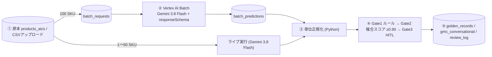

# AI Commerce Search 商品情報エンリッチメント スタジオ（PoC デモ）

Gemini（Vertex AI）で商品マスタの属性を **抽出 → 単位正規化 → 3段階ゲート判定 → ゴールデンレコード化** するプロセスを、直感的な画面で体験できるデモです。
商品情報エンリッチメントのアーキテクチャとミニマム PoC フローを実装しています。

- GCP プロジェクト: 環境変数 `PROJECT_ID` で指定（`.env` または Cloud Run 環境変数）
- Cloud Run: `aics-data-enrichment`（`SERVICE_NAME`、`REGION` 既定 `asia-northeast1`）
- BigQuery: `product_enrichment`（`BQ_DATASET`）／原本: `ai_commerce_search_dataset.products_aics`（`BQ_SOURCE_TABLE`、画像保存・資料反映時のみ更新。更新前に日次バックアップ `products_aics_backup_YYYYMMDD` を自動作成）
- モデル: `gemini-3.8-flash`（ライブ = オンライン、100 SKU = Vertex AI Batch Prediction）／画像生成: `gemini-3.1-flash-image`（既定）・`gemini-3-pro-image`
- GCS: `gs://products_images_${PROJECT_ID}`（`IMAGE_BUCKET`、生成画像 `{SKU}/{SKU}_{プリセット}_{日時}_{n}.jpg`、資料アップロード `_docs_uploads/{日付}/`）

## アーキテクチャ



| 原則 | 実装 |
|---|---|
| JSON Schema 強制 | `responseSchema`（属性キーは enum、根拠・確信度は必須）[app/schema.py](app/schema.py) |
| 抽出と単位正規化の分離 | Gemini は原文の値をそのまま転記 → 換算は [app/normalizer.py](app/normalizer.py) |
| 原本グラウンディング | 根拠スニペットを原本と文字列照合（一致 1.0 / 表記ゆれ 0.8 / 値のみ 0.5 / 不一致 0 → 強制レビュー）[app/rules.py](app/rules.py) |
| マルチステージ | Stage1 属性抽出 ／ Stage2 正規化 ／ Stage3 機能タグ・検索キーワード・要約 ／ GMC 会話属性生成 |

複合スコア = 0.5×根拠一致 + 0.3×自己確信度 + 0.2×トークン確率（`avgLogprobs` が得られない場合は 0.6 / 0.4）。

## 画面（全9画面）

| 画面 | 内容 |
|---|---|
| ダッシュボード (`#/dashboard`) | 属性充足率 Before→After、自動承認率、レビュー待ち、1SKU コスト、ゲートファネル、カテゴリ別比較 |
| 商品一覧 (`#/products`) | 状態・カテゴリで絞り込み、充足率バー |
| エンリッチ・スタジオ (`#/studio`) | 原本（Before）とエンリッチ後（After）を左右比較。属性カードにホバーすると原本の根拠がハイライト。「▶ Gemini でライブ実行」でステージが順に点灯 |
| CSV ライブテスト (`#/csv`) | 商品 CSV をアップロード（またはサンプル CSV 読込）し、`gemini-3.8-flash` でリアルタイムにエンリッチ実行＆BigQuery (`product_enrichment.*` 全5テーブル) に即時保存 |
| GMC 会話属性 (`#/gmc`) | [Google Merchant Center Conversational Attributes](https://support.google.com/merchants/answer/17085370?hl=en)（`question_and_answer`, `item_group_title`, `variant_option`, `related_product`, `product_highlight`, `product_detail`, `popularity_rank`, `document_link`）の生成・根拠検証・編集・TSV/CSV 補助フィード出力 |
| 季節画像スタジオ (`#/images/<SKU>`) | 登録画像（既定）／GCS パス／アップロード／Web 検索（Gemini Google 検索グラウンディング）をベースに、季節プリセット（夏：冷房・春：花粉・冬：暖房 など）＋追加プロンプトで 2〜4 枚を同時生成。**その機能がある商品だけ**プリセットが有効（根拠を表示）。出力サイズは既定 300×300（600／1024／元サイズを選択可）。選んだ画像を保存すると `product_images` と `products_aics.images` に追加 |
| 資料から抽出 (`#/docs`) | 画像・PDF・Excel・CSV を GCS パス指定またはアップロード → Gemini が商品情報を抽出 → 型番/JAN で SKU を自動マッチ（手動指定・新規登録も可）→ 差分（追加のみ／上書き）を確認 → 再エンリッチして BigQuery（`source_products` ほか）と `products_aics` を更新 |
| HITL レビュー (`#/reviews`) | 要レビュー項目を理由付きで表示。承認(A) / 修正(E) / 却下(R) |
| バッチ & コスト (`#/batch`) | Batch ジョブの一覧と投入、SKU 数スライダーによるコスト試算、ゴールデンレコードの CSV 出力 |

## 季節画像スタジオの使い方

1. 左メニュー「季節画像スタジオ」またはエンリッチ・スタジオの「🎨 季節画像を作る」から商品を選ぶ
2. ベース画像を選ぶ（既定は登録画像。画像がない商品は「Web検索」で候補から1枚選ぶ）
3. プリセットを選ぶ（グレーのプリセットは理由をホバーで確認。例: 花粉・空気清浄の記載がない商品では「春：花粉」は使えない）
4. 必要に応じて追加プロンプト・枚数（2〜4）・出力サイズ・アスペクト比・文字入れ・モデルを指定し「✨ 画像を生成」
5. 生成画像ごとの「商品一致スコア」（ベース画像との同一性を Gemini が判定。0.7 未満は ⚠）を確認し、選んで「保存」。不要な画像は 🗑 で GCS から削除

| プリセット（例） | 対象 | 有効になる条件（根拠） |
|---|---|---|
| 夏：冷房パワー ☀️ | エアコン | 冷房能力・畳数がある |
| 春：花粉・空気清浄 🌸 | エアコン | 承認済みタグ「空気清浄」または原文に 花粉／PM2.5／空気清浄／集じん（カテゴリ名は根拠にしない） |
| 梅雨：除湿 ☔ / 秋：お手入れ 🍂 / 冬：暖房 ❄️ | エアコン | 除湿・自動お掃除・暖房能力の記載 |
| 夏：自動製氷 🧊 / 年末：大容量 🎍 / 新生活：スリム 🌱 | 冷蔵庫 | 製氷・容量・サイズの記載 |
| 夏：涼しい風 / おでかけ / 冬：空気循環 | 扇風機・ハンディ | 充電式・サーキュレーター等の記載 |
| EC用 白背景 / ライフスタイル / セール | 全カテゴリ | 常に有効 |

> [!NOTE]
> 画像内の文字は既定で「なし」。「スペック入り」でも **承認済み属性の値だけ** をプロンプトに渡し、架空の性能値・認証マーク・価格は描かないよう指示しています。

## 資料から抽出の使い方

1. GCS パス（例 `gs://products_images_${PROJECT_ID}/_docs_samples/`）を入力して「一覧取得」、またはファイルをドラッグ＆ドロップ（1回最大 20 ファイル／1ファイル 30MB）
2. 「抽出開始」→ ファイルごとに Gemini が商品情報（型番・JAN・価格・説明・属性＋根拠・ページ）を抽出
3. 商品ごとに反映先を選ぶ：自動マッチした既存 SKU／別の SKU を指定／新規 SKU として登録／スキップ。「追加のみ（空欄を埋める）」か「上書き」を選び「差分を確認」
4. 「BigQuery に反映（再エンリッチ）」→ `source_products`（`updated_at` 付きで最新行が有効）・`enriched_attributes`・`sku_extras`・`golden_records`・`gmc_conversational`・`doc_extractions` に保存し、`products_aics` を MERGE で更新
5. エンリッチ・スタジオで、資料由来の値が「【資料】」セクションの根拠としてハイライトされることを確認

サンプル資料: [samples/docs/](samples/docs/)（架空商品の仕様書 PDF、価格表 xlsx、銘板写真 PNG）

## セットアップ / 実行

```bash
cp .env.example .env                                      # PROJECT_ID 等を設定
uv venv --python 3.11 venv && uv pip install --python venv/bin/python -r requirements.txt pytest httpx
PYTHONPATH=. venv/bin/python scripts/setup_bq.py          # テーブル作成 + 100 SKU サンプリング
PYTHONPATH=. venv/bin/python scripts/setup_bq.py --migrate-only  # 既存データを残したまま product_images / doc_extractions 作成・列追加
PYTHONPATH=. venv/bin/python scripts/submit_batch.py      # Vertex AI Batch 投入（--group / --limit 可）
PYTHONPATH=. venv/bin/python scripts/refresh_batch.py     # 状態確認・結果取込（サーバーも60秒ごとに自動取込）
PYTHONPATH=. venv/bin/uvicorn app.main:app --port 8090    # http://localhost:8090
OFFLINE=true PYTHONPATH=. venv/bin/pytest tests -q        # テスト（オフライン）
bash deploy.sh                                            # Cloud Run デプロイ（PROJECT_ID 必須）
```

> [!NOTE]
> - デモは Cloud Run 1 インスタンス（`max-instances=1`）で動かします。メモリ上のキャッシュを BigQuery に追記保存する設計です。
> - アプリ用テーブルへの書き込みは append-only（load job）です。`products_aics` だけはステージングテーブル経由の `MERGE`（id 単位）で更新し、その日の最初の更新前に CLONE バックアップを作成します。
> - `products_aics` から Retail API（検索カタログ）への再インポートは PoC の範囲外です。

API 仕様: [docs/API.md](docs/API.md)、[docs/API_images_docs.md](docs/API_images_docs.md)
